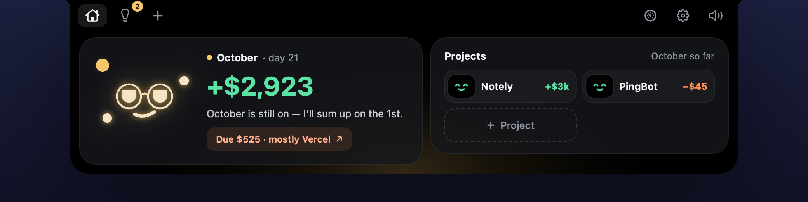
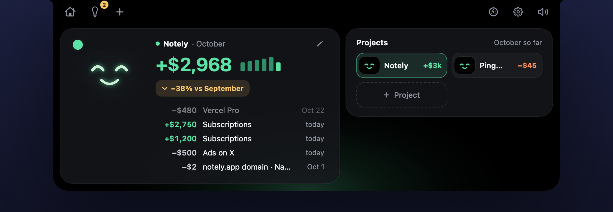
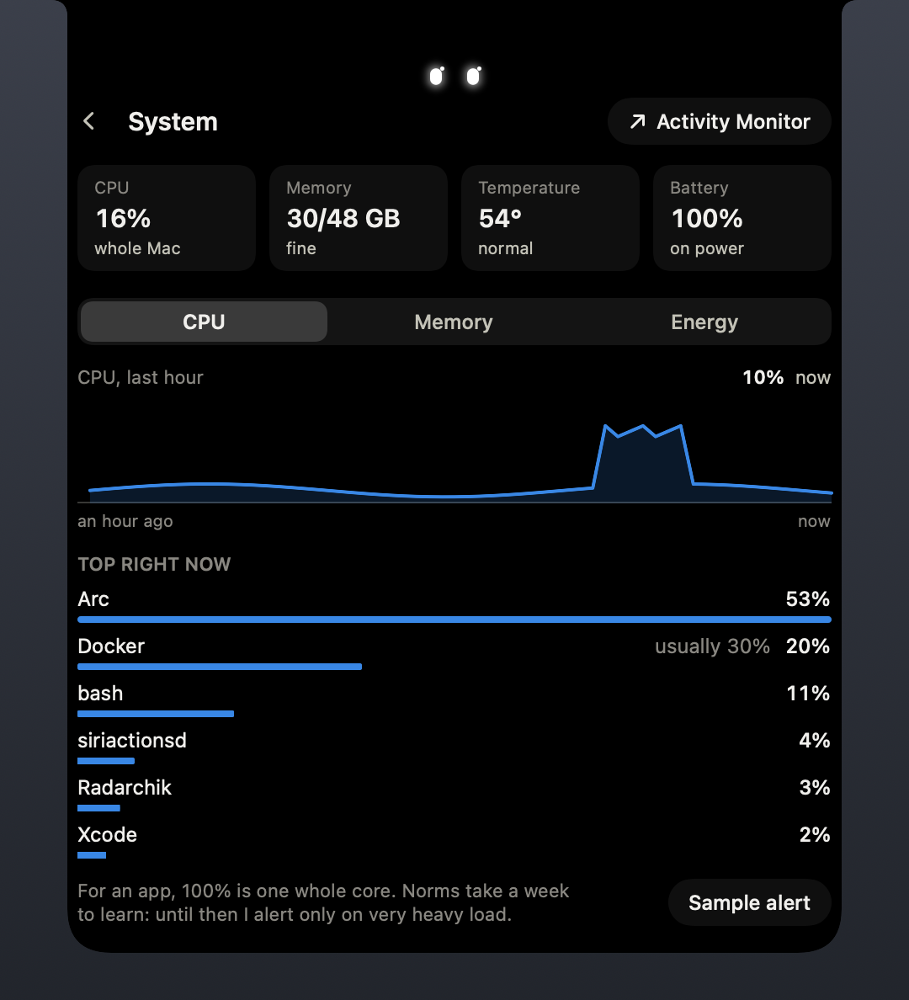
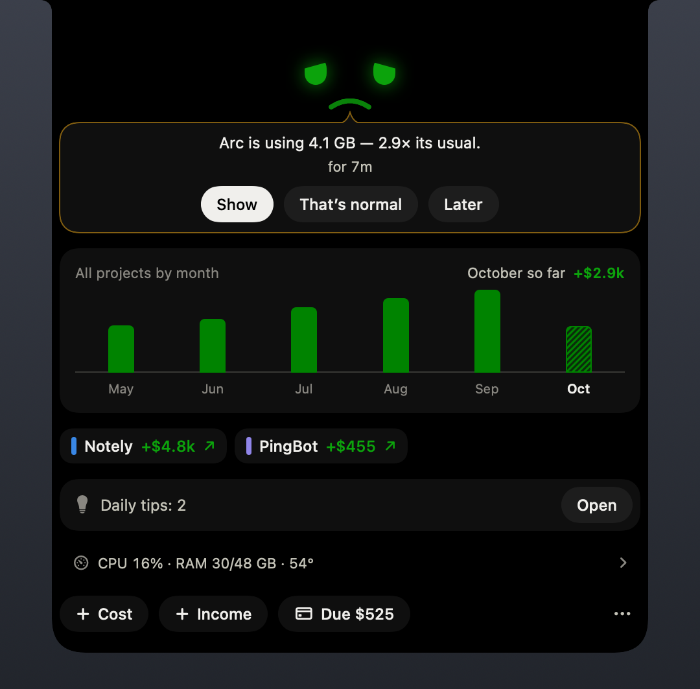
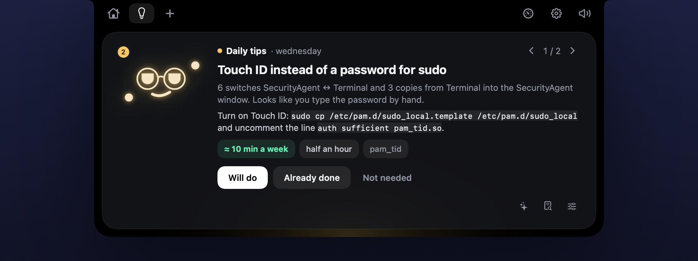
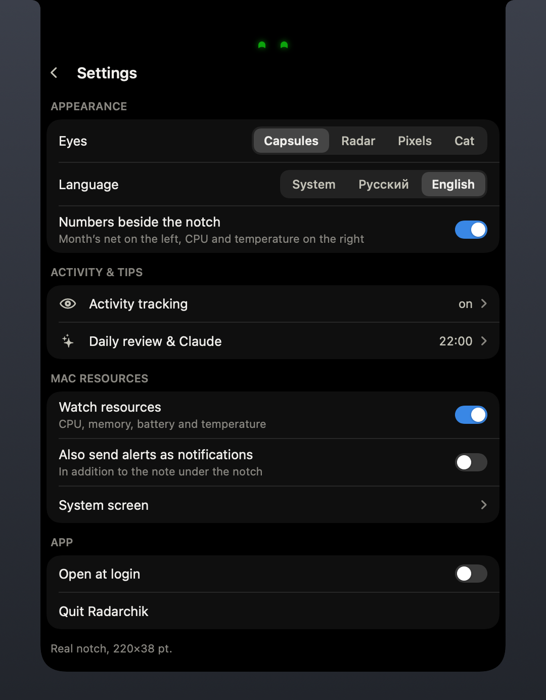

<p align="center">
  
</p>

<p align="center">
  <b>A tiny mascot that lives in your MacBook notch.</b><br>
  It keeps an eye on your side projects’ money, watches your Mac, and once a day asks Claude what in your routine could be automated.
</p>

<p align="center">
  <a href="README.ru.md">Русский</a> ·
  <a href="#install">Install</a> ·
  <a href="#privacy">Privacy</a> ·
  <a href="#development">Development</a>
</p>

<p align="center">
  
</p>

## What it does

**Money, right beside the notch.** Add your projects’ recurring costs once — monthly or yearly — and log income as it comes. The left wing shows this month’s net across all projects: red at the start of the month, because costs accrue from the 1st, and green as income lands. Hover the notch for the month’s net, a one-line take from Radarchik and a chip for every project.

**Where to pay.** Recurring costs grouped by where you pay them, with links to the dashboards. Yearly costs count as 1/12 a month in totals and show up in full in their renewal month.

**Your Mac’s resources.** CPU, memory, battery and temperature — on the right wing and on the System screen. When an app uses far more than its usual, an alert opens under the notch: “Arc is using 4.1 GB — 3× its usual”. Norms are learned per app over a week; “That’s normal” raises them.

**Guard (optional).** SSH, AWS and project keys stay locked; Touch ID opens them for a few minutes and a timer locks them again — the countdown sits in the notch. A terminal command that needs a key asks for Touch ID right there. Scripts and AI agents (Claude Code, Codex) that reach for your SSH key need Touch ID too, and the notch says who it was. Guard also flags suspicious processes, checks code after `git pull` and audits Claude Code’s settings. It needs a small root helper — see [Guard](#guard).

**Network watch.** For what you didn’t start yourself — scripts under npm, Claude Code tools — Radarchik notes every new address, with the chain of who launched it. A dependency calling a bare IP right after `npm install` raises an alarm with a Kill button. It isn’t a firewall: the connection is already out, so pair it with LuLu if you want to be asked first.

**“What is this?”** Any resource or Guard alert can ask Claude about the process behind it: its path, signature and launch chain go out, and back comes what it is, a verdict and what to do.

**Daily tips from Claude (optional).** With activity tracking on, Radarchik logs which apps and sites your day goes to, terminal command templates with secrets stripped, copy-paste flows between apps and calls. Once a day it sends an aggregated summary — never the raw log — to Claude with your own API key and shows 3–5 concrete tips: an alias, a script, a Shortcut.

**Quiet on calls.** While the microphone is in use, the numbers hide: you might be sharing your screen.

**English and Russian.** Follows the system language; you can switch it in Settings.

| | | |
|:---:|:---:|:---:|
|  |  |  |
| Summary | A project | System |
|  |  |  |
| An app uses more than usual | Daily tips | Settings |

## Privacy

- Everything lives on your Mac, in one SQLite file: `~/Library/Application Support/Radarchik/radarchik.sqlite`.
- Activity tracking is **off by default**. It never records the screen, keystrokes, clipboard contents or audio. Excluded apps and sites — password managers and banks out of the box — are skipped entirely. The log is kept for 30 days.
- Radarchik talks to the network only to ask Claude, at `api.anthropic.com`, with your key from the macOS Keychain: the daily review (the “What goes to Claude” screen shows exactly what is sent, and window titles can be left out) and “What is this?” when you press it (the process’s path, signature and launch chain).
- Guard’s root helper and the network watch work locally: they look only at where new connections go and who launched them, and that stays on your Mac unless you press “What is this?”.
- Need a proxy for the Claude API? Set an HTTP proxy in settings, and requests will go only through it.

## Install

Requirements: macOS 15 or later and Xcode 16 or later (Swift 6). It’s made for a MacBook with a notch; on other displays it draws a virtual one.

```sh
git clone https://github.com/kuzmenkonikolay/radarchik.git
cd radarchik
make install   # builds Radarchik.app, copies it to ~/Applications and opens it
```

Hover the notch to open the panel: the month’s total with a one-line take from Radarchik on the left, your projects as pills with mini-faces on the right. The toolbar in the notch’s “ears” leads to daily tips, a new entry, the Mac’s resources, Guard, the network and settings. New income, an upcoming charge, an app eating more than usual or a Guard alarm open as an alert that stays until you answer it.

- To log terminal commands, add the line shown on the Activity tracking screen to `~/.zshrc`. Guard uses the same line to ask Touch ID for commands that need a key.
- For daily tips, add an API key from [console.anthropic.com](https://console.anthropic.com) in “Daily review & Claude”.

> The app isn’t notarized yet. If you download a build from Releases, macOS will block the first launch — allow it in System Settings → Privacy & Security.

### Guard

Turn Guard on in Settings, then install its root helper once:

```sh
make install-guard     # builds the helper, shows the keys it will protect, asks for sudo, restarts Radarchik
```

It needs the **Radarchik dev** certificate below: the helper only talks to an app with that signature. After that, `make run` (or `make install`) rebuilds everything in one go and reinstalls the helper only when its code has changed. `make uninstall-guard` removes it and gives the keys back to you.

<details>
<summary>Permissions reset after every rebuild?</summary>

macOS ties Accessibility and Automation permissions to the code signature, and with ad-hoc signing every build looks like a new app. Create a self-signed code-signing certificate named **Radarchik dev** in Keychain Access (Certificate Assistant → Create a Certificate…, certificate type “Code Signing”). The Makefile picks it up automatically.
</details>

## Development

```sh
make test   # logic tests: money, formats, phrases, resources, SQLite
make run    # build and (re)launch; updates Guard’s root helper too if it’s installed and changed
make zip    # build/Radarchik.zip for GitHub Releases
```

- `Sources/RadarchikCore` — logic without UI, covered by tests.
- `Sources/Radarchik` — the app: the notch window (`Notch/`), screens (`Views/`), the mascot (`Mascot/`), activity tracking (`Observation/`), resources (`Resources/`), the daily review (`Review/`).
- UI strings live next to the code, in pairs: `L("Настройки", "Settings")`.

Everything visual renders without launching the app, which makes reviews easy:

```sh
.build/debug/Radarchik --render-screens <folder> --language en   # every screen as PNG
.build/debug/Radarchik --render-docs <folder> --language en      # the screenshots above
.build/debug/Radarchik --render-promo radarchik.mp4              # the promo video, add --format square for 1:1
.build/debug/Radarchik --render-icon <folder>                    # AppIcon.iconset, then iconutil -c icns
```

The promo video is rendered by the app itself: real SwiftUI views on demo data, frame by frame, encoded with AVFoundation.

## License

[MIT](LICENSE)
