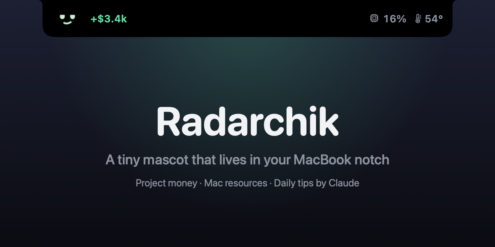
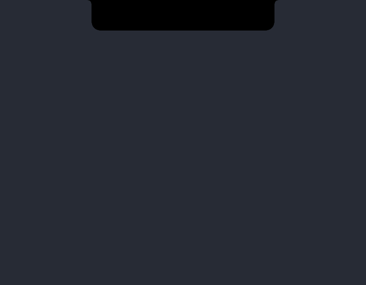
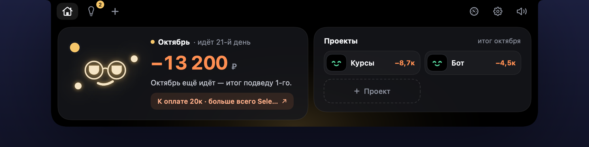
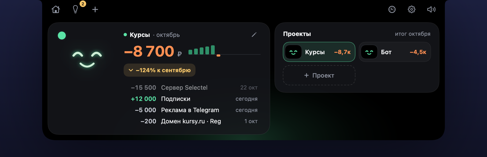
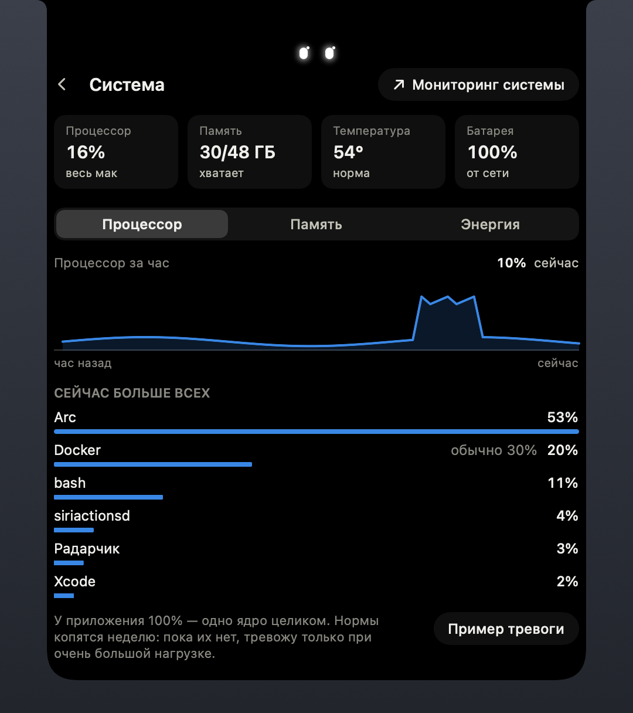
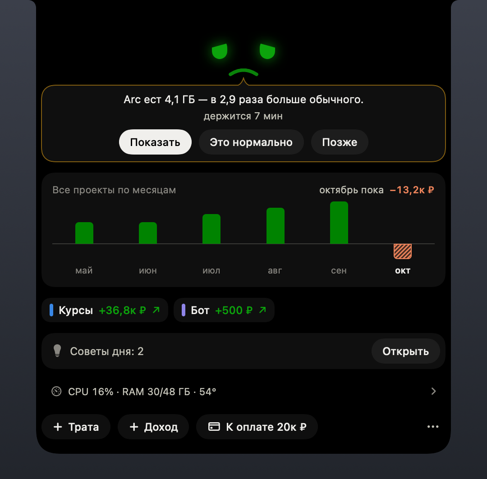
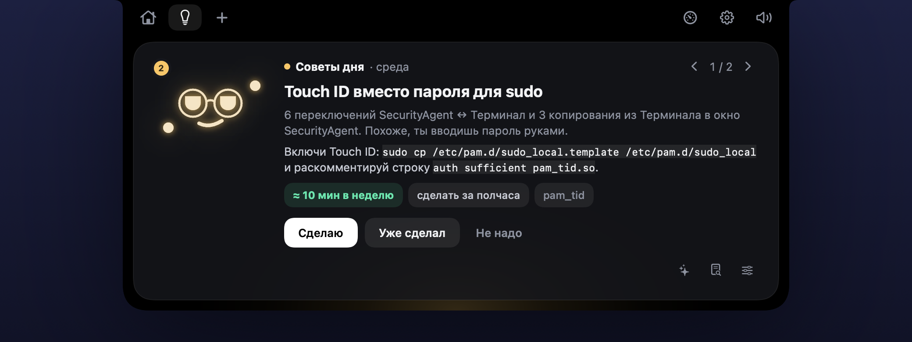
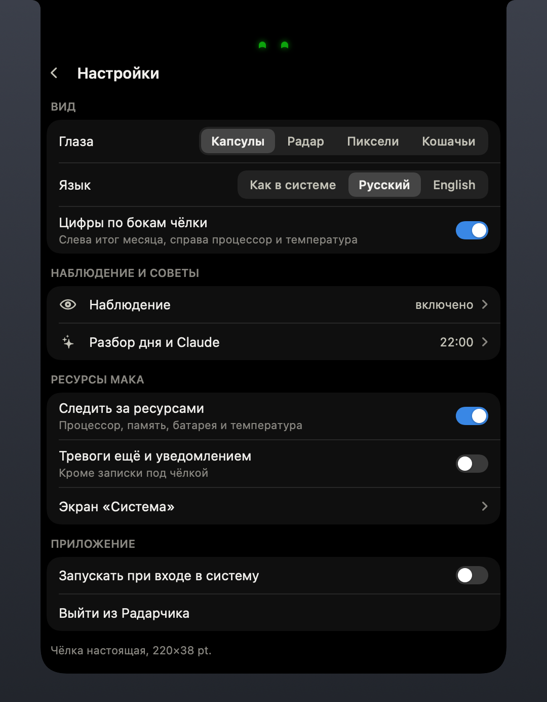

<p align="center">
  
</p>

<p align="center">
  <b>Маленький маскот, который живёт в чёлке MacBook.</b><br>
  Считает, в плюсе ли твои проекты, следит за ресурсами мака и раз в день спрашивает у Claude, что в твоей рутине можно автоматизировать.
</p>

<p align="center">
  <a href="README.md">English</a> ·
  <a href="#установка">Установка</a> ·
  <a href="#приватность">Приватность</a> ·
  <a href="#разработка">Разработка</a>
</p>

<p align="center">
  
</p>

## Что умеет

**Деньги прямо у чёлки.** Регулярные траты проектов заводишь один раз — помесячные или годовые, — доходы записываешь по мере поступления. Левое крыло показывает итог текущего месяца по всем проектам: в начале месяца он в минусе, потому что траты начислены с 1-го числа, и растёт по мере доходов. Наведи курсор на чёлку — там итог месяца, фраза от Радарчика и чипы проектов.

**Куда платить.** Регулярные траты сгруппированы по месту оплаты, со ссылками на кабинеты. Годовые в итогах идут по 1/12 в месяц, а в «Куда платить» — целиком в месяц продления.

**Ресурсы мака.** Процессор, память, батарея и температура — в правом крыле и на экране «Система». Когда приложение ест сильно больше обычного, под чёлкой раскрывается алерт: «Arc ест 4,1 ГБ — в 3 раза больше обычного». Нормы каждого приложения копятся неделю, кнопка «Это нормально» их поднимает.

**Защита (по желанию).** Ключи SSH, AWS и проектов закрыты; Touch ID открывает их на несколько минут, таймер закрывает обратно — отсчёт виден в чёлке. Команда терминала, которой нужен ключ, спрашивает Touch ID прямо на месте. Скриптам и ИИ-агентам (Claude Code, Codex), которые берут твой SSH-ключ, тоже нужен Touch ID, а чёлка скажет, кто это был. Ещё «Защита» замечает подозрительные процессы, проверяет код после `git pull` и настройки Claude Code. Ей нужна небольшая root-часть — см. [Защита](#защита).

**Сетевой надзор.** За тем, что запускал не ты, — скриптами под npm, инструментами Claude Code — Радарчик записывает каждый новый адрес с цепочкой, кто запустил. Зависимость сразу после `npm install` пошла на голый адрес — тревога с кнопкой «Убить». Это не файрвол: соединение уже ушло, поэтому, если хочешь, чтобы спрашивали до него, ставь рядом LuLu.

**«Что это?»** Любой алерт ресурсов или «Защиты» может спросить у Claude про процесс за ним: уходят путь, подпись и цепочка запуска, а возвращается, что это, вердикт и что делать.

**Советы дня от Claude (по желанию).** С включённым наблюдением Радарчик записывает, на какие приложения и сайты уходит день, шаблоны команд терминала без секретов, копирование между приложениями и звонки. Раз в день он отправляет в Claude сводку — не сырой лог — с твоим ключом API и показывает 3–5 конкретных советов: алиас, скрипт, команду Shortcuts.

**Тихий на звонках.** Пока микрофон занят, цифры прячутся: вдруг ты показываешь экран.

**Русский и английский.** Язык берётся из системы, переключить можно в настройках.

| | | |
|:---:|:---:|:---:|
|  |  |  |
| Сводка | Проект | Система |
|  |  |  |
| Приложение ест больше обычного | Советы дня | Настройки |

## Приватность

- Всё хранится на маке, в одном файле SQLite: `~/Library/Application Support/Radarchik/radarchik.sqlite`.
- Наблюдение **по умолчанию выключено**. Оно никогда не пишет экран, нажатия клавиш, содержимое буфера и звук. Приложения и сайты из исключений — из коробки это менеджеры паролей и банки — пропускаются целиком. Лог хранится 30 дней.
- В сеть Радарчик ходит только к Claude, на `api.anthropic.com`, с твоим ключом из Связки ключей macOS: разбор дня (экран «Что уходит в Claude» показывает ровно то, что отправляется, а заголовки окон можно не отправлять) и «Что это?», когда ты его нажал (путь процесса, подпись и цепочка запуска).
- Root-часть «Защиты» и сетевой надзор работают на месте: смотрят только, куда идут новые соединения и кто их запустил, и это остаётся на маке, пока не нажмёшь «Что это?».
- Нужен прокси для Claude API — впиши HTTP-прокси в настройках, и запросы пойдут только через него.

## Установка

Нужны macOS 15 или новее и Xcode 16 или новее (Swift 6). Радарчик сделан для MacBook с чёлкой; на других экранах он рисует виртуальную.

```sh
git clone https://github.com/kuzmenkonikolay/radarchik.git
cd radarchik
make install   # собирает Radarchik.app, кладёт в ~/Applications и открывает
```

Наведи курсор на чёлку — откроется панель: слева итог месяца и одна фраза от Радарчика, справа проекты пилюлями с мини-лицами. Тулбар в «ушах» выреза ведёт к советам дня, новой записи, ресурсам мака, «Защите», сети и настройкам. Новый доход, скорое списание, приложение, которое ест больше обычного, или тревога «Защиты» раскрываются алертом, который висит, пока не ответишь.

- Чтобы записывались команды терминала, добавь в `~/.zshrc` строку с экрана «Наблюдение». Та же строка нужна «Защите», чтобы спрашивать Touch ID у команд, которым нужен ключ.
- Для советов дня добавь ключ API с [console.anthropic.com](https://console.anthropic.com) в «Разбор дня и Claude».

> Приложение пока не нотаризовано. Если скачаешь сборку из Releases, macOS заблокирует первый запуск — разреши его в Системных настройках → Конфиденциальность и безопасность.

### Защита

Включи «Защиту» в настройках, потом один раз поставь её root-часть:

```sh
make install-guard     # собирает root-часть, показывает, какие ключи будет защищать, спрашивает sudo, перезапускает Радарчик
```

Нужен сертификат **Radarchik dev** (см. ниже): root-часть разговаривает только с приложением с этой подписью. Дальше `make run` (или `make install`) пересобирает всё одной командой и переставляет root-часть, только когда изменился её код. `make uninstall-guard` убирает её и возвращает ключи тебе.

<details>
<summary>Разрешения сбрасываются после каждой сборки?</summary>

macOS привязывает разрешения Accessibility и Automation к подписи, а с подписью ad-hoc каждая сборка выглядит новым приложением. Создай в Связке ключей самоподписанный сертификат для подписи кода с именем **Radarchik dev** (Ассистент сертификации → Создать сертификат…, тип «Подпись кода») — Makefile подхватит его сам.
</details>

## Разработка

```sh
make test   # тесты логики: деньги, форматы, фразы, ресурсы, SQLite
make run    # собрать и (пере)запустить; root-часть «Защиты», если стоит и изменилась, обновит тоже
make zip    # build/Radarchik.zip для GitHub Releases
```

- `Sources/RadarchikCore` — логика без UI, покрыта тестами.
- `Sources/Radarchik` — приложение: окно над чёлкой (`Notch/`), экраны (`Views/`), маскот (`Mascot/`), наблюдение (`Observation/`), ресурсы (`Resources/`), разбор дня (`Review/`).
- Тексты интерфейса лежат прямо в коде, парами: `L("Настройки", "Settings")`.

Всё, что видно на экране, рисуется без запуска приложения — удобно для ревью:

```sh
.build/debug/Radarchik --render-screens <папка> --language ru   # все экраны в PNG
.build/debug/Radarchik --render-docs <папка> --language ru      # скриншоты выше
.build/debug/Radarchik --render-promo radarchik.mp4             # промо-ролик, --format square — квадратный
.build/debug/Radarchik --render-icon <папка>                    # AppIcon.iconset, дальше iconutil -c icns
```

Промо-ролик рисует само приложение: настоящие SwiftUI-экраны на выдуманных данных, кадр за кадром, кодирует AVFoundation.

## Лицензия

[MIT](LICENSE)
